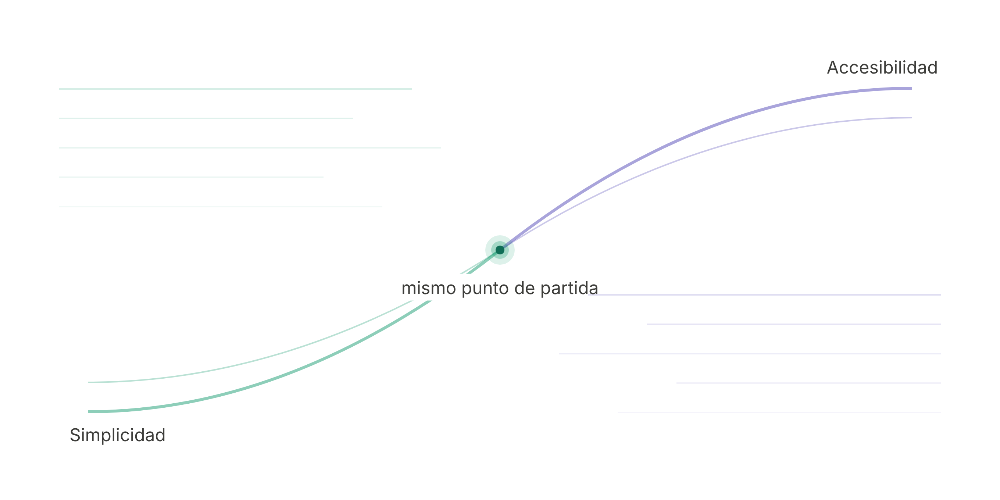
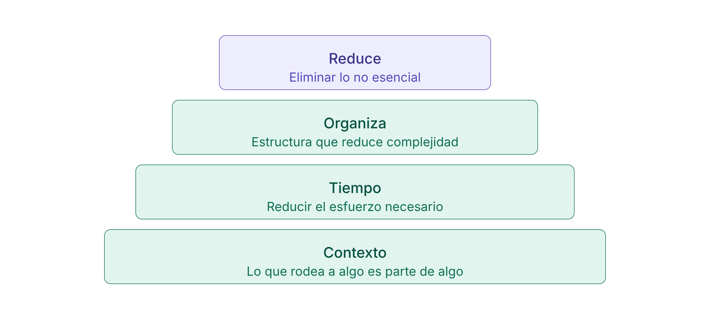
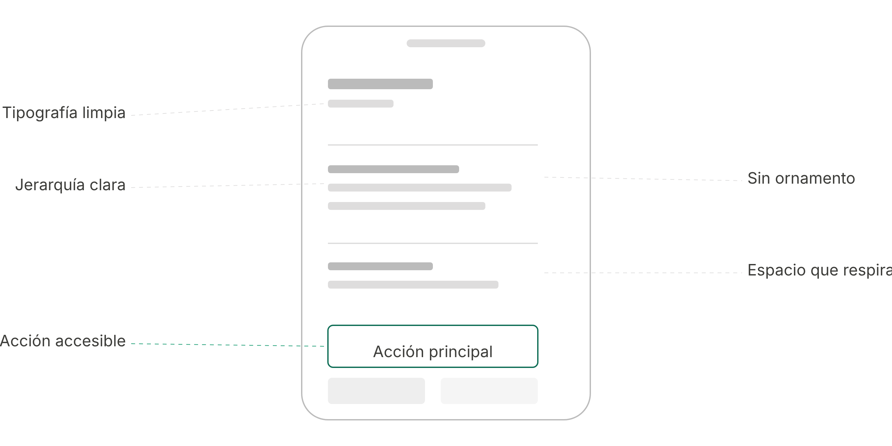
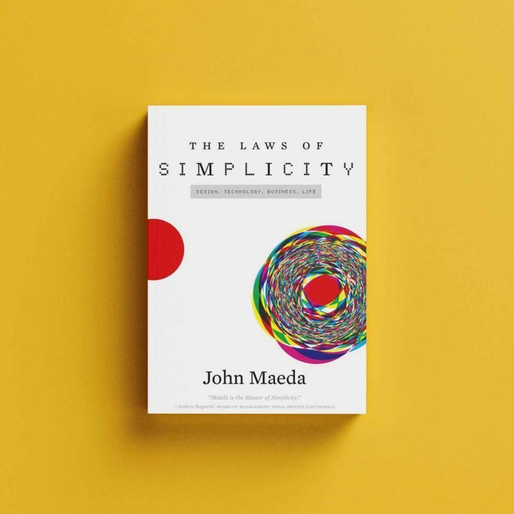

Hace 20 años, John Maeda publicó _The Laws of Simplicity_. No hablaba de accesibilidad digital. Pero cambió para siempre mi forma de entender el diseño.

Con el tiempo, trabajando en proyectos digitales, he vuelto muchas veces a esas ideas. Y cada vez las leo desde otro lugar.

Hoy, más que nunca, la relación entre simplicidad y accesibilidad resulta evidente.

## Simplicidad y accesibilidad comparten el mismo punto de partida

Diseñar no consiste en añadir capas. Consiste en tomar decisiones.

Reducir lo que no aporta. Ordenar lo que permanece. Dar forma a la información para que se entienda y se pueda usar.

Cuando esto ocurre, la experiencia se vuelve clara. Y cuando es clara, se vuelve accesible. No como una capa añadida. Como una consecuencia directa del diseño.

## 4 leyes de la simplicidad en la práctica digital

### Ley 1 · Reduce

_Eliminar lo que no es esencial._

Interfaces más limpias.  
Menos ruido.  
Decisiones más evidentes.

Cuando el contenido respira, la interacción fluye. Y más personas pueden orientarse sin esfuerzo.

Para quien navega con un lector de pantalla, una página con 80 enlaces, tres banners rotativos y un pop-up de cookies no es una página rica. Es un mapa de ruido.

Reducir no es un lujo estético.

Es la condición previa para que todo lo demás funcione.

### Ley 2 · Organiza

_Dar estructura a lo que comunicamos._

Jerarquía clara.  
Navegación coherente.  
Contenido ordenado.

Cuando la información está bien organizada, se entiende sin fricción.

Un encabezado H1 no es una letra grande. Es el título del documento.  
Cuando usamos la jerarquía de encabezados correctamente, quien navega con un lector de pantalla puede saltar directamente a la sección que le interesa.

Es exactamente lo mismo que hace visualmente cualquier lector cuando escanea una página. La estructura semántica no es una capa encima del diseño.

Es el diseño.

### Ley 3 · Tiempo

_Reducir el esfuerzo necesario para usar algo._

Procesos directos.  
Interacciones previsibles.  
Instrucciones claras.

Cuando una experiencia no exige esfuerzo extra, se vuelve más usable.

No todo el mundo interactúa a la misma velocidad. Una persona con temblor en las manos necesita más tiempo para completar un formulario. Una persona que usa un puntero ocular para navegar necesita más tiempo para cada clic.

El WCAG lo recoge en el criterio 2.2.1, pero la idea de fondo es mucho más sencilla: el tiempo es parte del diseño.

### Ley 6 · Contexto

_Lo que rodea a algo es parte de algo._

Un botón que dice “Leer más” tiene sentido junto a un titular y una imagen. Visualmente, el contexto lo hace comprensible.

Pero para quien navega tabulando por los elementos interactivos de la página, ese botón dice simplemente “Leer más”. Sin contexto. Sin significado.

A veces añadir contexto hace que algo parezca más simple, no más complejo. Un campo de formulario con una etiqueta bien escrita y un mensaje de error que explica qué ha fallado y cómo corregirlo reduce la carga cognitiva aunque técnicamente tenga más elementos.

## Hacer simple lo complejo

### En diseño, muchas veces el trabajo no consiste en añadir,_sino en decidir qué sobra._

Simplificar una interfaz, un texto o una interacción implica entender qué es esencial y qué puede desaparecer. Quitar todo lo que no aporta. Ordenar lo que queda. Hacer que funcione.

Cuando eso ocurre, la experiencia se vuelve más accesible. No como un requisito técnico, sino como una forma natural de diseñar.

Simple no es vacío.  
Simple no es minimalista por obligación.  
Simple es quitar lo que no tiene función, y articular bien lo que sí la tiene.

## Un ejemplo contemporáneo:

### Nothing

Hay pocas empresas que hayan hecho de la simplicidad visual un argumento tan consistente como Nothing.

Sus interfaces son monocromáticas, tipográficamente limpias, sin ornamento. Pero más allá de la estética, lo interesante es lo que hay debajo: cuando el entorno visual ya ha eliminado el ruido, las opciones de accesibilidad funcionan mejor. Las fuentes grandes se adaptan sin competir con nada. El alto contraste tiene menos interferencias. La reducción no es decorativa. Es estructural.

Nothing no se presenta como una empresa de accesibilidad. Pero muchas de sus decisiones van en esa dirección. Hacer lo digital más claro, más directo, más usable.

Es un buen recordatorio de que la simplicidad bien aplicada no es un estilo. Es una condición que facilita que más personas puedan usar lo que diseñamos.

## 20 años después

### Han pasado dos décadas desde que _The Laws of Simplicity_ puso palabras a una forma de entender el diseño.

### Hoy, en el contexto digital, esa misma idea sigue vigente.

Cuando algo se entiende, se puede usar.  
Y cuando se puede usar, se vuelve accesible.

No hay separación entre accesibilidad, diseño y comunicación.  
Es una misma conversación.

Accesibilidad Primero. Siempre.  
Va por ti John
