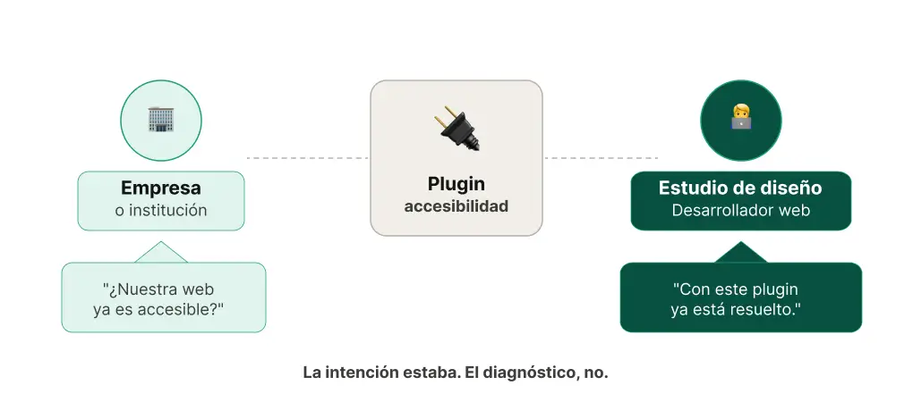
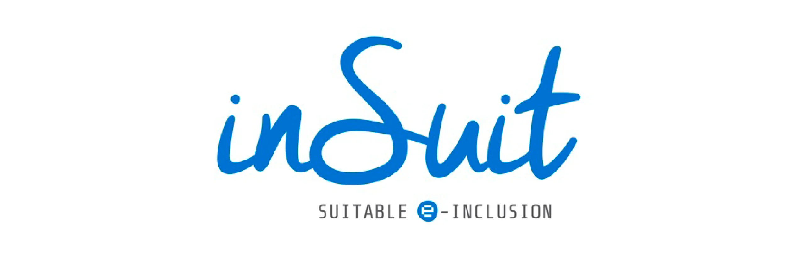
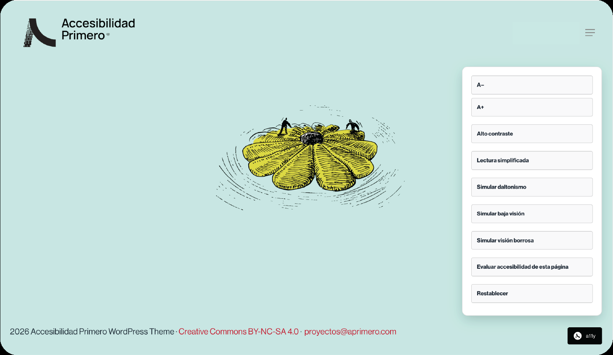

La directora de una asociación que lleva años trabajando para que personas con discapacidad y sus familias tengan acceso a los recursos que necesitan. Cuando su organización renovó la web hace algo más de un año, el estudio de diseño les dijo que con un plugin de accesibilidad la web ya sería accesible.

Les explicaron cómo funcionaba, les hicieron una formación, y ella lo asumió de buena fe. Tenía sentido: hay un problema, existe una herramienta, la herramienta resuelve el problema.

El problema es que no funciona así. Y esto no es un error suyo ni de su organización.

Es un error que se repite constantemente en el mercado, y la responsabilidad no está en las organizaciones que contratan webs, sino en los estudios de diseño y desarrollo que siguen vendiendo los plugins de accesibilidad como solución cuando, en el mejor de los casos, son un complemento.

## Qué hace bien un plugin de accesibilidad

Antes de explicar sus límites, conviene ser justos con lo que estos plugins sí aportan. Su función principal es dar a la persona usuaria una capa de personalización visual: aumentar el tamaño del texto, activar un modo de alto contraste, cambiar el cursor, detener animaciones, o en algunos casos leer el contenido de la página en voz alta.

Son herramientas de presentación. Actúan sobre cómo se muestra la web, no sobre cómo está construida.  
Y dentro de ese marco, algunos lo hacen bien.

De origen español, es una plataforma orientada a entidades públicas e instituciones.

Ofrece un panel lateral con opciones de personalización visual y algunas funciones de lectura.

Está presente en webs de la administración y del tercer sector.

Es un plugin para WordPress muy extendido entre sitios de mediana escala.

Proporciona un conjunto de ajustes visuales que cada persona puede activar, incluyendo opciones para dislexia y bajo contraste.

Es el referente global del sector, con presencia en millones de sitios web. Su panel incluye perfiles de accesibilidad predefinidos, lectores de página y opciones de navegación por teclado.

Es también uno de los más cuestionados técnicamente, y ha acumulado críticas serias de la comunidad especializada precisamente por venderse como sustituto de una implementación correcta.

Todos ellos tienen algo en común: funcionan sobre lo que la web les da.  
Si la web no está bien construida, el plugin no puede compensarlo.

## El muro: lo que ningún plugin puede improvisar

Aquí está el núcleo del problema, y hay que nombrarlo con claridad porque es lo que el mercado está ignorando sistemáticamente.

Un plugin de accesibilidad no puede hacer accesible una web que no lo es en su estructura. No porque los plugins sean malos, sino porque hay decisiones de arquitectura que tienen que tomarse antes de que exista una sola línea de código visible, y esas decisiones no se pueden aplicar desde el exterior una vez que la web está construida.

Algunos ejemplos concretos:

### Tipografía en unidades relativas _(REM)_.

Si los tamaños de texto están definidos en píxeles fijos, la persona usuaria puede aumentar el tamaño desde su navegador o desde el plugin, pero el diseño se romperá, el texto se solapará, o simplemente el plugin no podrá escalar lo que el código no permite escalar.

Esta decisión se toma en el CSS, no en el panel de control del plugin.

### Texto alternativo en imágenes

Un plugin puede añadir un campo para que la persona usuaria active un “modo descripción”, pero si las imágenes no tienen atributo alt escrito en el HTML, un lector de pantalla simplemente no tiene nada que leer.

El plugin no puede inventar el contexto que la imagen no tiene declarado.

### HTML semántico.

La jerarquía de encabezados (h1, h2, h3…), los landmarks de navegación (nav, main, footer), la estructura de listas: todo esto es el esqueleto que los lectores de pantalla usan para navegar.

Si una web usa div y span donde debería usar etiquetas semánticas, el lector de pantalla recibe una página plana sin estructura.

El plugin no puede reconstruir una arquitectura que no existe.

### Etiquetas en formularios

Un formulario de contacto con campos sin label correctamente asociado es invisible para quienes usan lectores de pantalla.

No saben qué dato se les está pidiendo en cada campo.

Un plugin puede añadir un overlay visual, pero la relación entre el campo y su etiqueta tiene que estar en el código.

Todos ellos tienen algo en común: funcionan sobre lo que la web les da.  
Si la web no está bien construida, el plugin no puede compensarlo.

### Contraste de color nativo

Si el diseño original tiene texto gris claro sobre fondo blanco, el plugin puede ofrecer un “modo alto contraste”.

Pero ese modo es una sobreescritura forzada sobre un diseño que no cumple los criterios mínimos de ratio de contraste definidos por las WCAG.No es accesibilidad, es un parche.

La conclusión es incómoda pero necesaria:

### Si una web no fue desarrollada con accesibilidad primero, un plugin no la hace accesible.

La hace parecer que tiene algo de accesibilidad.Y hay una consecuencia legal que hay que añadir: ninguna normativa vigente, ni las WCAG, ni el [Real Decreto 1112/2018](https://www.boe.es/diario_boe/txt.php?id=BOE-A-2018-12699) para el sector público en España, ni la futura aplicación de la [Directiva Europea de Accesibilidad](https://www.boe.es/buscar/doc.php?id=DOUE-L-2019-80999), considera que una web con un plugin de accesibilidad cumple los requisitos de conformidad.

El cumplimiento normativo exige que la web, en su código base, sea accesible. El plugin no cuenta.

## El sobrecoste de no hacerlo desde el principio

Este es el argumento que los estudios de diseño deberían tener muy presente, porque es el que acaba llegando a la mesa del cliente cuando la web ya está lanzada.

Varios análisis del sector cifran el sobrecoste de adaptar una web no accesible entre un (60% y un 600% más) respecto a haberla construido con accesibilidad integrada desde el inicio.

La horquilla es amplia porque depende del tamaño del sitio y de cuántas decisiones estructurales incorrectas hay que deshacer, pero incluso en el escenario más optimista, siempre es más caro.

La razón es arquitectónica: los problemas de jerarquía de encabezados, semántica de marcado o arquitectura de componentes personalizados pueden requerir cambios en todo el código, no en una página concreta. Un estudio que no incluye accesibilidad en su proceso de diseño y desarrollo no está abaratando el proyecto, está transfiriendo ese coste al cliente en forma de deuda técnica que tarde o temprano habrá que pagar.

Para quienes quieran profundizar en el argumento económico, el W3C mantiene documentación específica sobre el impacto financiero de la accesibilidad web en su sección de casos de negocio [Financial Factors in Developing a Web Accessibility Business Case W3C/WAI](https://www.w3.org/WAI/business-case/archive/fin), donde se detalla cómo el coste es significativamente menor cuando se integra desde el inicio.

Otras fuentes que respaldan las cifras del sobrecoste: [AudioEye - Website Accessibility vs. Lawsuit Costs](https://www.audioeye.com/post/website-accessibility-vs-lawsuit-costs/), [HTD Health - The True Cost of Accessibility](https://htdhealth.com/insights/the-true-cost-of-accessibility-why-adding-accessibility-later-can-cost-10x-more/), [A11yProof - Accessibility Remediation Pricing Guide](https://a11yproof.com/resources/guides/accessibility-remediation-pricing-guide).

## Nuestro widget A11y:

### Una herramienta que parte de otra premisa

En Accesibilidad Primero hemos desarrollado nuestro propio widget de accesibilidad, A11y Widget, disponible exclusivamente para los sitios web que trabajamos con nosotros.

Y lo hemos construido con una filosofía exactamente opuesta a la que acabamos de describir.

El widget A11y no es una solución. Es una capa adicional de personalización para personas con baja visión o daltonismo, diseñada para funcionar encima de una base ya accesible. No tapa agujeros.

No imposta semántica que no existe. Simplemente añade opciones de presentación para quien las necesita, en una web que ya cumple los criterios técnicos sin él.

La diferencia no es de tecnología. Es de orden.  
Primero la accesibilidad, en el código, en la estructura, en el diseño. Después, si tiene sentido, la capa de personalización.

Eso es lo que cualquier organización merece recibir cuando confía en un estudio de diseño para construir su presencia digital.

¿Quieres una web accesible?  
[Cuéntanos tu proyecto](/contacto/)
