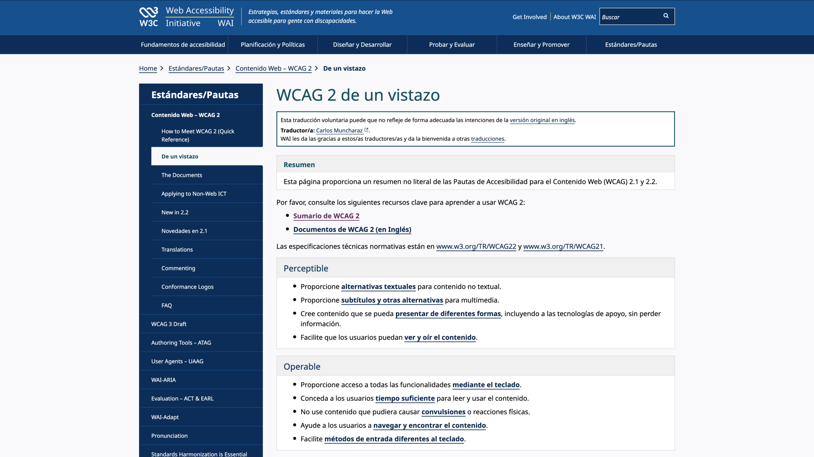
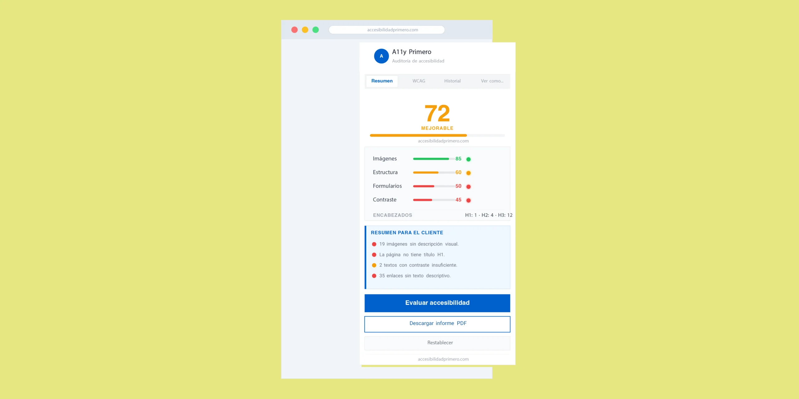

Hay un documento que está detrás de casi todo lo que consideramos “buenas prácticas” en accesibilidad digital. No es un manifiesto ni una ley. Es un conjunto de recomendaciones técnicas que lleva décadas actualizándose y siendo la referencia que, si trabajas con lo digital necesitas conocer.

Se llama WCAG. Y este post va de eso.

## ¿Qué es la WCAG?

WCAG son las siglas de _Web Content Accessibility Guidelines_, las Pautas de Accesibilidad para el Contenido Web. Las publica el W3C, el consorcio que define los estándares de la web, a través de su grupo de trabajo sobre accesibilidad, el WAI.

La primera versión apareció en 1999. La más usada hoy es la WCAG 2.1, publicada en 2018. Y en 2023 llegó la WCAG 2.2, que añade criterios nuevos especialmente pensados para personas con discapacidad cognitiva y usuarias de dispositivos móviles. No son una ley en sí mismas. Son recomendaciones técnicas. Pero se han convertido en la referencia global que adoptan legislaciones, contratos públicos y estándares de calidad en todo el mundo, incluyendo la normativa española y europea.

> Las WCAG no te dicen cómo tiene que ser tu web. Te dicen qué tiene que conseguir. La diferencia importa.

## Cómo se organiza:

### Los cuatro principios

### Perceptible

La información tiene que poder percibirse. Si solo existe en formato visual, quien no puede ver se queda fuera. Si solo hay audio, quien no puede escuchar también. Los textos alternativos en imágenes, los subtítulos en vídeos, el contraste de color suficiente: todo esto vive aquí.

### Operable

La interfaz tiene que poder usarse. No todo el mundo usa ratón. Hay personas que navegan solo con teclado, con un pulsador, con la voz. Si tu web no puede operarse sin ratón, estás excluyendo a una parte de tu audiencia.

### Comprensible

El contenido y el funcionamiento tienen que entenderse. Esto incluye el lenguaje claro, la consistencia en la navegación, los mensajes de error que explican qué ha pasado y cómo solucionarlo.

### Robusto

El contenido tiene que funcionar con las tecnologías actuales y futuras. Un lector de pantalla, un navegador antiguo, un dispositivo de asistencia. El código tiene que estar bien construido para que esas herramientas puedan interpretarlo. Esto es lo que en accesibilidad se conoce como POUR (por sus siglas en inglés).  
Es el marco conceptual sobre el que se construyen todos los criterios.

## Los niveles de conformidad:

### A, AA y AAA

Cada criterio de las WCAG tiene un nivel de conformidad asignado:

| Nivel | Qué significa | Cuándo aplica |
|---|---|---|
| A | El mínimo imprescindible. Sin esto, hay barreras graves. | Siempre |
| AA | El nivel de referencia. Lo que exige la normativa en la mayoría de contextos. | Organismos públicos, empresas con obligación legal |
| AAA | El nivel más exigente. No siempre es posible alcanzarlo en todo el contenido. | Contextos específicos de alta accesibilidad |

Cuando la normativa española o europea habla de accesibilidad web, el nivel exigido es el AA.  
Es el punto de referencia real para la mayoría de proyectos.

Ejemplo concreto:

> El criterio 1.4.3 (Contraste mínimo) es de nivel AA. Exige que el texto tenga una relación de contraste de al menos 4.5:1 con el fondo.

¿Qué significa eso en la práctica? Que ese gris clarito sobre fondo blanco que tanto gusta en los diseños minimalistas probablemente no cumple. Y que hay personas con baja visión que directamente no pueden leer ese texto.

## Por qué es la referencia global

### ¿Por qué las WCAG se han convertido en el estándar?

Porque llevan décadas de trabajo real detrás. Cada criterio ha sido debatido, probado y validado por investigadores, personas con discapacidad, desarrolladores y diseñadores de todo el mundo. No son opiniones: son evidencia acumulada sobre qué funciona y qué no.

Además, son tecnológicamente neutras. No te dicen “usa este framework” ni “escribe el código así”. Te dicen qué tiene que conseguir tu implementación, sea cual sea la tecnología que uses. Y son versionadas. Cuando la web cambia,y cambia constantemente, las WCAG se actualizan. La versión 2.2 añadió criterios nuevos precisamente porque la web de 2023 no es la web de 2008.Cuando la normativa española o europea habla de accesibilidad web, el nivel exigido es el AA.  
Es el punto de referencia real para la mayoría de proyectos.

Ejemplo concreto:

> El criterio 1.4.3 (Contraste mínimo) es de nivel AA. Exige que el texto tenga una relación de contraste de al menos 4.5:1 con el fondo.

¿Qué significa eso en la práctica? Que ese gris clarito sobre fondo blanco que tanto gusta en los diseños minimalistas probablemente no cumple. Y que hay personas con baja visión que directamente no pueden leer ese texto.

## WCAG y normativa:

### Qué te obliga y qué no

En España, el “Real Decreto 1112/2018·” transpone la Directiva Europea de Accesibilidad Web y obliga a los organismos del sector público a cumplir el nivel AA de las WCAG 2.1. Esto incluye administraciones, universidades públicas, organismos oficiales y entidades financiadas con fondos públicos.

Para el sector privado, la situación está cambiando. La “Ley Europea de Accesibilidad” (European Accessibility Act), cuya implementación en España está en proceso, amplía las obligaciones a empresas que ofrezcan determinados productos y servicios digitales.

En resumen:

| Quién | Obligación actual |
|---|---|
| Organismos públicos | WCAG 2.1 nivel AA obligatorio |
| Universidades y centros educativos públicos | WCAG 2.1 nivel AA obligatorio |
| Empresas privadas (ciertos sectores) | Obligación creciente con la nueva normativa |
| Cualquier organización | Buena práctica y responsabilidad ética |

> Lo que hoy es voluntario para muchas organizaciones, mañana será obligatorio. La pregunta no es si hay que cumplirlo, sino cuándo empezar.

## WCAG y SEO:

### Dos objetivos, un mismo camino

Este es uno de los puntos que más sorprende a quien se acerca a las WCAG por primera vez: cumplir las pautas de accesibilidad y mejorar el posicionamiento en buscadores van casi siempre de la mano.

¿Por qué? Porque Google funciona de forma parecida a un lector de pantalla. No “ve” tu web: la lee, la interpreta, analiza su estructura. Y valora exactamente las mismas cosas que valoran las personas que usan tecnologías de asistencia.

> Ejemplos concretos de cómo la accesibilidad mejora el SEO

| Criterio WCAG | Lo que mejora en accesibilidad | Lo que mejora en SEO |
|---|---|---|
| Textos alternativos en imágenes (1.1.1) | Personas ciegas pueden entender las imágenes | Google indexa el contenido de las imágenes |
| Jerarquía de encabezados (1.3.1) | Facilita la navegación con lector de pantalla | Estructura el contenido para los rastreadores |
| Títulos de página descriptivos (2.4.2) | Orientan a quien llega a la página | Son el primer elemento que Google evalúa |
| Texto de enlaces descriptivo (2.4.4) | “Descargar informe” en vez de “clic aquí” | Palabras clave en los textos de enlace mejoran el posicionamiento |
| Velocidad y código limpio (robusto) | Mejor experiencia para todos | Factor de posicionamiento directo |

Una web construida siguiendo las WCAG es, casi por definición, una web con código semántico, bien estructurada y fácil de interpretar. Eso no solo ayuda a las personas: también le habla con claridad a Google.

Al contrario también es verdad: una web llena de imágenes sin texto alternativo, con encabezados desordenados y enlaces genéricos tipo “más información” está perjudicando a sus usuarias y a su posicionamiento al mismo tiempo.

## WCAG y responsabilidad:

### Más allá del cumplimiento

Cumplir las WCAG es el paso más tangible para demostrar que el compromiso con la inclusión no se queda en las palabras.

Hay organizaciones que hablan de diversidad en su comunicación pero tienen una web que excluye a personas con discapacidad. Eso es una contradicción visible. Y las personas que la perciben (usuarias, aliadas, comunidades) lo notan.

La accesibilidad web es la única forma de garantizar que el mensaje de “somos una organización inclusiva” se traduzca en algo concreto. Un sitio que cumple las WCAG elimina barreras reales. No es un gesto: es una decisión estructural.

Esto tiene impacto en varios niveles:

> Ejemplos concretos de cómo la accesibilidad mejora el SEO

### Coherencia institucional

Una universidad, un museo, una entidad cultural o un centro educativo que habla de inclusión y tiene una web inaccesible está enviando un mensaje contradictorio. Las WCAG son la forma de cerrar esa brecha.

### Alcance real

Según la OMS, más del 15% de la población mundial tiene algún tipo de discapacidad. No cumplir las WCAG significa, en la práctica, excluir a una parte significativa de tu audiencia potencial.

### Reputación y confianza

La accesibilidad es cada vez más un criterio de calidad visible. Organizaciones que priorizan la accesibilidad digital se posicionan como referentes éticos en su sector.

> La accesibilidad no es una capa extra que se añade al final. Es una forma más rigurosa y respetuosa de diseñar desde el principio.

## El enfoque

### Accesibilidad Primero

El error más habitual que vemos en proyectos digitales es usar las WCAG solo como lista de verificación al final del proceso. “Hemos terminado el proyecto, ahora hacemos la auditoría de accesibilidad.”

Ese enfoque es el más costoso. Detectar problemas de accesibilidad cuando el diseño ya está cerrado y el código ya está escrito significa rehacerlo. Y eso tiene un coste económico real, además de uno reputacional si el problema se detecta desde fuera.

La alternativa es integrar las WCAG desde el principio: en las decisiones de diseño, en los criterios de desarrollo, en los procesos de revisión de contenido.

No es una auditoría al final, sino una forma de trabajar desde el inicio. Las ventajas son claras:

### Menos deuda técnica

Los problemas se previenen, no se parchean.

### Alcance real

Productos digitales más robustos e intuitivos.

### Reputación y confianza

Corregir en producción es siempre más caro que diseñar bien desde el principio.

## Por dónde empezar

### Si nunca has trabajado con las WCAG y no sabes por dónde empezar, aquí tienes una entrada razonable:

- Lee los cuatro principios POUR y entiende qué cubre cada uno
- Identifica el nivel de conformidad que aplica a tu organización (casi siempre AA)
- Haz una auditoría básica de tu web actual: contraste de color, textos alternativos, navegación por teclado
- Revisa si tu proceso de diseño y desarrollo contempla la accesibilidad desde el inicio o solo al final
- Consulta la documentación oficial del W3C, está en español y es más legible de lo que parece

Las WCAG no son un obstáculo. Son el camino hacia un entorno digital más justo, más usable y más honesto con la diversidad real de las personas que lo usan. Si quieres saber cómo integramos las WCAG en cada proyecto desde el primer paso, [te lo contamos en Estudio](/estudio/).

## A11y Primero

### Nuestra extensión para auditar WCAG desde el navegador

Hay muchas herramientas para auditar accesibilidad web. WAVE, axe, Lighthouse… las conocemos y las usamos. Son potentes. Pero están pensadas para perfiles de desarrollo, no para personas que diseñan, auditan y además tienen que comunicarle los resultados a un cliente de forma comprensible.

Ninguna se ajustaba exactamente a lo que necesitábamos en el día a día. Así que construimos la nuestra.

Junto a Claude, llevamos meses desarrollando “A11y Primero”, una extensión propia para Chrome que audita accesibilidad web pensada desde dentro para responder a dos situaciones que vivimos en cada proyecto, (puedes leer el proceso de la extensión [aquí](/blog/a11yprimero/)):

### En la reunión con cliente

Necesitamos que entienda el problema, no abrumarle con tecnicismos. Score visual, semáforo por categorías, lenguaje claro. Simple, como nos gusta.

### En el informe técnico

Necesitamos precisar qué falla, dónde y cómo corregirlo. Criterios WCAG, nivel A/AA, selector CSS del elemento exacto.

Lo que no encontrábamos en ninguna otra herramienta era esto: que ambas cosas estuvieran juntas, en el mismo sitio, y con historial para poder comparar las mejoras de accesibilidad después de aplicarlas.

> _Diseñar accesibilidad también es diseñar cómo se comunica la accesibilidad. Y “A11y Primero” nace justo ahí._

Estamos en la v1.7 y seguimos desarrollando. Pronto la tendrás disponible en la Chrome Web Store.

→ Si quieres probar la versión Beta, [probar A11y Primero para Chrome](mailto:proyectos@accesibilidadprimero.com)
