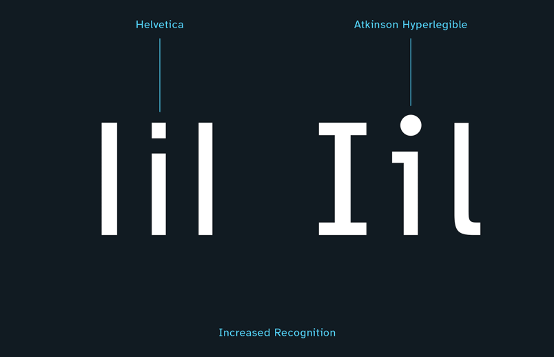
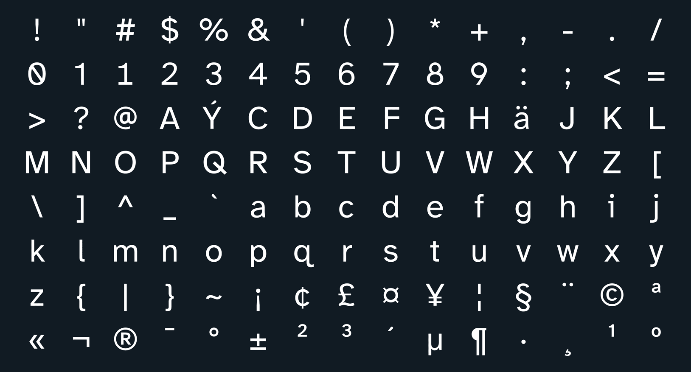
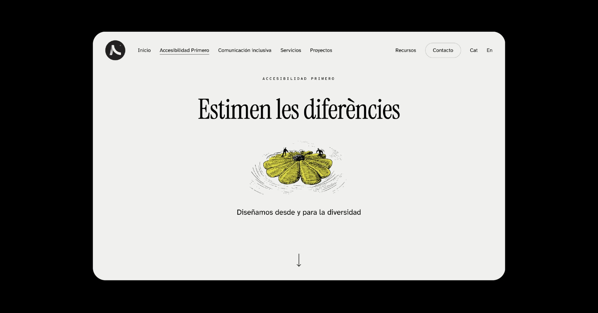

Este artículo cuenta cómo elegimos la tipografía de la versión anterior de esta web. La web actual usa Instrument Sans. Lo que aprendimos sobre tipografía accesible sigue valiendo.

## 1. El problema

Cuando empezamos a plantear el diseño de la web de Accesibilidad Primero, una de las decisiones a la que le dimos más vueltas fue la tipografía.

Cuando diseñas una web para tu propio proyecto, pasas por procesos un poco “obsesivos” y ese proceso fue el de llegar a una tipografía que representara el propósito de “Accesiilidad Primero”.

Pasamos semanas testeando fuentes. Ninguna nos convencía del todo. Y en ese proceso aprendimos más sobre accesibilidad tipográfica de lo que habríamos aprendido leyendo cualquier documentación.

Este artículo es el resumen de ese proceso: qué probamos, por qué no funcionó, y cómo llegamos a “Atkinson Hyperlegible Next“.

## 2. Las fuentes que probamos antes

Teníamos claro desde el principio que la tipografía de nuestra web tenía que estar a la altura del mensaje. No podíamos hablar de accesibilidad y tener una web con una fuente que no la cumpliera. Eso habría sido una contradicción demasiado visible.

Así que empezamos a testear.

### Manrope

de Mikhail Sharanda

Fue de las primeras que pusimos sobre la mesa. Es una sans-serif geométrica moderna, con muy buena presencia en pantalla y una personalidad limpia que encajaba con la estética que buscábamos. El problema apareció en los tamaños pequeños: algunos caracteres se vuelven ambiguos. La ‘l’ minúscula y la ‘I’ mayúscula son demasiado similares.

Para una web de accesibilidad, eso era un problema que no podíamos ignorar.

### Inter

Rasmus Andersson

Es probablemente la fuente más usada en interfaces digitales ahora mismo, y hay razones para eso: es extremadamente versátil, legible y bien construida. La probamos durante un tiempo. Pero cuanto más avanzábamos en el proyecto, más incómoda nos resultaba la elección. Inter está diseñada para interfaces en general. Nosotros necesitábamos algo que hablara específicamente de legibilidad y accesibilidad, no solo que la cumpliera por defecto.

Nos quedamos un tiempo con “Manrope”.

Lanzamos la web con esta tipografía, pero no terminaba de ser la respuesta correcta para este proyecto en concreto. No estábamos satisfechos con esta desición

El problema no era encontrar una fuente atractiva y legible. Era encontrar una fuente que, por su propio origen y diseño, apoyara y se sumara a nuestro discurso de marca.

## 3. el proceso

### Cómo llegamos a Atkinson Hyperlegible Next

Después de lanzar la web y con el afán de cuestionarlo todo, nos planteamos la pregunta: ¿existe alguna tipografía que haya sido diseñada específicamente para accesibilidad?*

La respuesta es sí y nos la dió el mismísimo Google. Y se llama «Atkinson Hyperlegible».

En 2019, el Braille Institute de Los Ángeles, una organización centenaria dedicada a personas con discapacidad visual, encargó el diseño de una tipografía desde cero. Para resolver un problema real: sus materiales impresos y digitales usaban fuentes estándar que, para muchas de las personas a las que querían llegar, seguían siendo difíciles de leer.

La encargaron a Applied Design Works con un lineamiento muy concreto: cada carácter debe ser inconfundible con cualquier otro. Cada letra, cada número, cada símbolo tenía que poder distinguirse aunque el ojo no funcionara al cien por cien.

El nombre es un homenaje a J. Robert Atkinson, fundador del instituto.

El resultado fue Atkinson Hyperlegible, y en 2023 llegó Atkinson Hyperlegible Next, (tipografía con la que lees esto), la versión actualizada con un sistema de pesos más completo, mejor soporte de idiomas y refinamientos tipográficos que la hacen todavía más versátil para uso digital. Lo que más nos convenció no fue solo que fuera legible. Fue que cada decisión de diseño tiene una razón de ser vinculada a la accesibilidad:

– La ‘l’ minúscula tiene una curva en la base para que nunca se confunda con la ‘I’ mayúscula ni con el número ‘1’  
– El ‘0’ tiene una pequeña muesca para diferenciarlo de la ‘O’  
– Los puntos de la ‘i’ y la ‘j’ son cuadrados, no circulares, para mayor visibilidad a tamaños reducidos  
– Las aperturas de letras como ‘c’, ‘e’ y ‘a’ son más amplias, facilitando la distinción de formas  
– La altura de x (la proporción de las letras minúsculas) es generosa, lo que mejora la legibilidad en tamaños pequeños

Y además es completamente libre, [disponible en Google Fonts.](https://fonts.google.com/specimen/Atkinson+Hyperlegible+Next?preview.script=Latn)Cuando encontramos Atkinson Hyperlegible Next, no fue una decisión de diseño. Fue una decisión de coherencia. Esta fuente no cumple la accesibilidad por accidente: fue diseñada exactamente para eso.

## 4. Accesibilidad y diseño.

### Accesibilidad y diseño con singularidad no se contradicen.

Hay una pregunta que aparece casi siempre cuando hablamos de accesibilidad tipográfica: ¿y esto no limita el diseño?

La respuesta corta es no. Y nuestra propia web es la demostración.

Mientras definíamos Atkinson Hyperlegible Next para el cuerpo de texto, la interfaz y todo el contenido informativo, surgió una decisión paralela: ¿qué hacemos con los titulares de las hero sections? Esas pantallas de entrada, donde el impacto visual importa tanto como el mensaje.

Aquí tomamos una decisión (que en diseño editorial es usual): usar una «fuente display» específicamente para los titulares.

La tipografía elegida fue «Instrument Serif».

Instrument Serif es una tipografía serif con mucho carácter, elegante, con contraste marcado entre trazos, con una presencia que a tamaños grandes funciona como una declaración.

La clase de fuente que dice algo antes de que leas el titular.

La clave está en el uso restringido: solo en los h1 de las hero sections. Ni en el cuerpo, ni en los títulos de sección, ni en los botones.

Solo ahí, donde el tamaño es grande, el contexto es de impacto y la función es emocional antes que informativa. Eso nos dejó con un sistema tipográfico de dos niveles muy claro:

| Nivel | Tipografía | Uso | Objetivo |
|---|---|---|---|
| Display | Instrument Serif | Titulares de las secciones de apertura | Personalidad, impacto, memoria |
| Funcional | Atkinson Hyperlegible Next | Cuerpo, interfaz, contenido y el resto de títulos | Legibilidad, accesibilidad, claridad |

Este sistema hace algo que nos parece importante demostrar: «a accesibilidad no obliga a renunciar a la identidad visual de tu marca». Puedes tener una web singular, con contraste tipográfico, con momentos de impacto, y al mismo tiempo garantizar que todo el contenido que importa es legible para todo el mundo.¿Esto significa que a partir de ahora utilizaremos “Atkinson Hiperlegible” en todos nuestros proyectos digitales?

Para ser honesto, en principio para los textos sí. Pero no siempre, cada proyecto tiene su singularidad, a partir de ahora comienza una investigación sobre tipografías accesibles que iremos incorporando a nuestro catálogo.

## 5. Tipografía accesible: tamaños, espaciado y contrasteo

Elegir las tipografías fue solo la primera parte del proceso. La segunda, y tan importante como esta, fue entender que una buena fuente mal dimensionada, con poco interlineado o con contraste insuficiente sigue siendo un problema de accesibilidad.

En el siguiente artículo contamos todo eso: qué tamaños aplicamos y por qué, la diferencia entre píxeles y rem que tanto impacta en accesibilidad, los errores que encontramos en nuestra propia web y el checklist completo que usamos en auditorías.

→ Tipografía accesible: tamaños, espaciado y contraste — lo que dice la WCAG y lo que aplicamos nosotros (Artículo en proceso)

Mientras tanto puedes curiosear el apartado de diseño [→](/estudio/)
